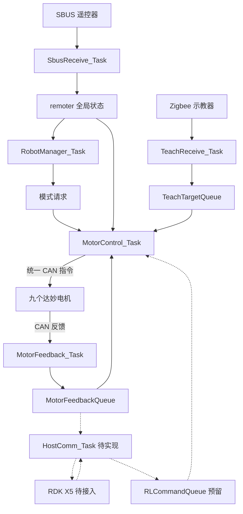

# 接触网机器人下位机控制系统

本项目用于接触网机器人关节运动、夹持与拧螺丝机构的下位机控制。系统以达妙 H7 控制板为主控，基于 STM32H723、STM32 HAL 和 FreeRTOS，控制左臂 4 个、右臂 5 个达妙电机。

工程由原 RoboMaster 框架逐步调整而来，采用任务层、模块层和板级支持层组织代码，支持示教操作与遥控拧螺丝，并为 RDK X5 上位机部署强化学习策略预留通信及控制入口。

## 系统组成

| 组成 | 职责 | 接口 |
| --- | --- | --- |
| 达妙 H7 控制板 | 工作模式管理、电机控制、反馈采集 | STM32H723，FreeRTOS |
| 左臂执行机构 | 两个普通关节、一个夹爪、一个拧螺丝电机 | CAN1，4 个达妙电机 |
| 右臂执行机构 | 三个普通关节、一个夹爪、一个拧螺丝电机 | CAN2，5 个达妙电机 |
| SBUS 遥控器 | 选择工作模式，控制两个拧螺丝电机 | UART5 |
| 示教器 | 提供五个普通关节、两个夹爪的七路输入 | Zigbee，经 USART1 接收 |
| RDK X5 上位机 | 后续运行强化学习策略，交换控制指令与反馈 | 预留 USART10，通信业务待接入 |

当前五个普通关节采用位置速度模式，两个夹爪采用 MIT 力矩控制，两个拧螺丝电机采用速度模式。九电机统一 MIT 控制将在后续接入。

## 工作模式

| 模式 | 七个示教电机 | 两个拧螺丝电机 |
| --- | --- | --- |
| 示教 | 示教器控制五个普通关节和两个夹爪 | 遥控器控制，可与示教同时操作 |
| 中间档 | 切入时设置原初始姿态目标 | 允许遥控操作 |
| RL | 预留强化学习控制全部九个电机的入口 | 随 RL 控制，遥控拧螺丝逻辑不参与 |

模式由遥控器拨杆选择。管理任务提交模式请求，电机控制任务在下一个控制周期开始时采纳。RL 指令尚未接入，当前进入该模式时，普通关节用有效反馈建立保持目标，夹爪力矩和拧螺丝速度清零。

## 框架分层

| 层次 | 目录 | 职责 |
| --- | --- | --- |
| 任务与控制逻辑 | `source/task/` | 模式管理、目标计算、统一电机发送、反馈汇总、遥控与示教接收 |
| 设备与算法模块 | `source/module/` | SBUS、Zigbee、达妙电机协议及保留的 IMU 算法 |
| 板级支持 | `source/bsp/` | CAN、UART、GPIO 中断、BMI088、DWT 和 RTT 接口 |
| 公共工具 | `source/library/` | 浮点编码、字符串转换等工具 |
| 外设与系统入口 | `Core/` | CubeMX 外设初始化、中断入口与 RTOS 对象创建 |

BSP 和模块说明与源码放在同一目录，并按功能命名，例如 `can_api.md`、`sbus.md`、`damiao_motor.md`。项目级架构、开发规范和问题记录保存在 `doc/`。

## 任务分工

系统创建六个业务任务，另保留默认任务。示教、拧螺丝和 RL 的运动逻辑以周期函数运行在统一电机控制任务中。

| 任务 | 优先级 | 职责 |
| --- | --- | --- |
| `RobotManager_Task` | Normal | 根据遥控器拨杆提交工作模式请求 |
| `MotorFeedback_Task` | Normal | 每 20 ms 刷新九电机反馈，发布完整快照 |
| `MotorControl_Task` | BelowNormal | 初始化电机，每 20 ms 处理模式、计算目标并统一发送 CAN |
| `SbusReceive_Task` | Low | 接收解析 SBUS，更新遥控器全局状态 |
| `TeachReceive_Task` | Low | 接收示教器输入，发布最新七路目标 |
| `HostComm_Task` | Low | 预留上下位机通信入口，目前为空任务 |
| `defaultTask` | Low | 保留默认空循环 |

`MotorControl_Task` 按模式调用 `TeachControl_Update()`、`ScrewControl_Update()` 或 `RLControl_Update()`。这些函数更新同一份九电机目标数组，随后由 `SendMotorCommands()` 统一发送。管理任务不挂起或恢复控制任务，模式切换在周期边界完成。

## 数据流



虚线表示待接入链路。三个队列长度均为 1，用于保存最新消息。

| 数据 | 写入方 | 读取方 | 交互方式 |
| --- | --- | --- | --- |
| 遥控器状态 | `SbusReceive_Task` | 管理及控制逻辑 | 全局变量 |
| `TeachTargetQueue` | `TeachReceive_Task` | 示教控制函数 | 覆盖写入，取出后检查时间 |
| `MotorFeedbackQueue` | `MotorFeedback_Task` | 电机控制任务，后续增加通信任务 | 覆盖写入，Peek 读取完整副本 |
| `RLCommandQueue` | 后续通信任务 | 后续 RL 控制函数 | 已创建，业务收发待接入 |

## 电机对应关系

九电机数组按左臂四个、右臂五个排序。

| 下标 | 实机电机 | 仿真名称 | 作用 |
| --- | --- | --- | --- |
| 0 | 左臂电机 1 | `joint_1` 主臂 | 普通关节 |
| 1 | 左臂电机 2 | `joint_4` 左腕 | 普通关节 |
| 2 | 左臂电机 3 | 左夹爪丝杠电机 | 夹持 |
| 3 | 左臂电机 4 | 左套筒电机 | 拧螺丝 |
| 4 | 右臂电机 1 | `joint_2` 中间关节 | 普通关节 |
| 5 | 右臂电机 2 | `joint_3` 主臂 | 普通关节 |
| 6 | 右臂电机 3 | `joint_5` 右腕 | 普通关节 |
| 7 | 右臂电机 4 | 右夹爪丝杠电机 | 夹持 |
| 8 | 右臂电机 5 | 右套筒电机 | 拧螺丝 |

示教器七路输入顺序为左 1、左 2、左夹爪、右 1、右 2、右 3、右夹爪。两个拧螺丝电机的目标在控制周期内单独生成。

## 目录与阅读入口

```text
catenary_robot/
├── Core/                       外设初始化、中断与 RTOS 对象创建
├── source/
│   ├── task/                   机器人任务、模式与周期控制函数
│   ├── module/                 设备协议和算法，说明与源码同目录
│   ├── bsp/                    板级接口，说明与源码同目录
│   └── library/                公共工具
├── Drivers/                    STM32 HAL、CMSIS 与 DSP
├── Middlewares/                FreeRTOS 等中间件
├── doc/                        项目架构、规范与问题记录
└── RMtextH7.ioc                 CubeMX 工程配置
```

建议从 [RobotManager.c](source/task/RobotManager.c) 和 [MotorControl.c](source/task/MotorControl.c) 了解模式与执行入口，再阅读 [MotorFeedback.c](source/task/MotorFeedback.c)、[TeachReceive.c](source/task/TeachReceive.c) 和 [robot_messages.h](source/task/robot_messages.h)，了解反馈和目标传递。

设备接口说明见 [CAN](source/bsp/can/can_api.md)、[UART](source/bsp/uart/uart_api.md)、[SBUS](source/module/Dbus/sbus.md)、[Zigbee](source/module/Zigbee/zigbee.md) 和 [达妙电机](source/module/motor/motor_DM/damiao_motor.md)。详细设计与维护资料从 [文档索引](doc/documentation_index.md) 进入。

电机公共结构与驱动组织见 [电机模块总览](source/module/motor/motor.md)，日志使用方法见 [RTT 日志说明](source/bsp/rtt/rtt.md)。

## 当前进展

任务组织、模式切换、示教目标队列、九电机反馈队列和统一 CAN 发送入口已接入。上下位机协议、`HostComm_Task` 业务及 RL 指令消费尚未完成，九电机统一 MIT 控制后续进行。

BMI088 驱动和 Mahony 算法保留，当前下位机不创建旧 IMU 任务；上位机 IMU 数据计划由 RDK X5 直接通过串口获取。硬件验证状态和底层待处理问题见 [代码问题记录](doc/reviews/code_review_issues.md)。
